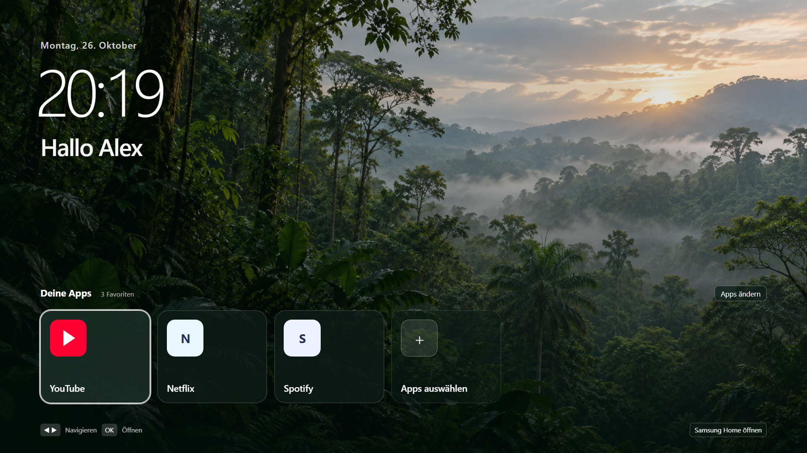

# Luma Home for Samsung S95B

A quiet rainforest home screen for a Samsung S95B TV. It shows a clock, date, rotating greeting and your chosen apps. The Samsung Smart Remote controls everything. The original Samsung Home remains available from an on-screen button.

**Tested device:** Samsung **QE55S95BATXXH (S95B)** · firmware **T-PTMDEUC-1720.7** · Tizen 6.5 · Luma Home **1.2.0**.

<p align="center"></p>

> Die Oberfläche wurde auf einem Samsung QE55S95BATXXH getestet. Die App lässt sich normal installieren; die optionale Umstellung der Home-Taste ist ein separater, undokumentierter Eingriff. Die Schritt-für-Schritt-Anleitungen stehen in [`docs/INSTALL.md`](docs/INSTALL.md) und [`docs/HOME-BUTTON.md`](docs/HOME-BUTTON.md).

## What is verified

| Feature | Result on the tested TV |
| --- | --- |
| Home screen | Clock, date, gentle greeting animation and local rainforest image run smoothly. |
| App tiles | Installed apps can be pinned, unpinned and launched with the remote. Up to seven favorites fit on the home screen. |
| App picker | Pinned apps appear first. Search opens with **OK**, filters by name or app ID, and returns focus to the results when the keyboard closes. Entries named only “App” are hidden. |
| Remote Home button | After the optional native mapping, **YouTube → Home → Luma** and **Netflix → Home → Luma** worked. |
| Original Samsung Home | **Samsung Home öffnen** in Luma opened the original, usable Smart Hub after the mapping. |

Power-on startup has **not** been verified. The native Home mapping was tested on the device and firmware above; it is not a supported Tizen web-app setting or a general procedure for other TVs.

## Get started

1. Install [Tizen Studio with the TV tools](https://developer.samsung.com/smarttv/develop/getting-started/setting-up-sdk/installing-tv-sdk.html), enable Developer Mode on the TV, and create a Samsung TV signing certificate for your device.
2. Clone this repo and package the six files in `app/` with your own certificate profile:

   ```powershell
   git clone https://github.com/mschr703/samsung-s95b-tizen-home-launcher.git
   cd samsung-s95b-tizen-home-launcher
   tizen package -t wgt -s YOUR_PROFILE -- app
   ```

3. Follow [`docs/INSTALL.md`](docs/INSTALL.md) to connect with SDB, install the generated `.wgt`, and launch Luma. It works as a regular pinned TV app without changing the Home button.
4. If you want the physical **Home** button to open Luma, read [`docs/HOME-BUTTON.md`](docs/HOME-BUTTON.md) and save the TV's original values before any change. The original Samsung interface remains accessible from Luma.

## Use and customize

- In Luma, choose **Apps auswählen** or **Apps ändern** to edit favorites. The selected apps are at the top. Move **Up** from the first app to the search button; press **OK** to type; choose **Done** or **Back** on the TV keyboard to return to the results.
- Edit `GREETINGS` and `DEFAULT_NAMES` in [`app/main.js`](app/main.js) to change the example greetings and initial favorites. Only installed apps matching those names are shown.

  ```js
  var GREETINGS = ["Hallo Alex", "Hallo Sam", "Willkommen zu Hause"];
  var DEFAULT_NAMES = ["youtube", "netflix", "spotify"];
  ```

  Existing favorites are saved on the TV. Changing `DEFAULT_NAMES` only takes effect when no favorites have been saved; use the app picker to edit an already configured TV.
- Edit [`app/style.css`](app/style.css) for layout and animation, or replace [`app/rainforest-bg.png`](app/rainforest-bg.png) with another local image.
- Keep the application ID consistent between [`app/config.xml`](app/config.xml) and the native helpers if you change it. See [`AI-HANDOVER.md`](AI-HANDOVER.md).

## Repository guide

| If you want to… | Start here |
| --- | --- |
| Install or update the ordinary TV app | [`docs/INSTALL.md`](docs/INSTALL.md) |
| Map or restore the remote Home button | [`docs/HOME-BUTTON.md`](docs/HOME-BUTTON.md) |
| Give an assistant the technical context and known pitfalls | [`AI-HANDOVER.md`](AI-HANDOVER.md) |
| Change the interface | [`app/`](app/) |
| Inspect the experimental native implementation | [`native/`](native/) |

The app is plain HTML, CSS and JavaScript with no hosted service. Device serial numbers, DUIDs, local IPs, signing certificates and native baseline files are not part of this repository. Keep your own baseline and certificate private; restore Samsung Home before uninstalling Luma if you mapped the Home button to it.

## Credits and license

Luma Home is MIT licensed; see [`LICENSE`](LICENSE). The native helper draws on [Arn0 TV](https://github.com/NelsonEU/arn0-tv) and the SDB transport in [samsung-tv-launcher](https://github.com/chaosmanage/samsung-tv-launcher). Their MIT notices are retained in [`native/`](native/). Samsung's [Application API](https://developer.samsung.com/smarttv/develop/api-references/tizen-web-device-api-references/application-api.html) documents ordinary app discovery and launch; the native Home mapping is outside that public API.
